# Alexander Cyon — Principal Engineer · Rust · Swift · Cryptography

15+ years shipping production software: **Rust SDKs and core protocols, applied cryptography, crypto wallets, and iOS apps**. Based in Stockholm, Sweden, open to remote.

**Open to full-time roles.** I prefer B2B invoicing through my company, Alexander Cyon Consulting AB, but I'm open to EOR.

📫 alex [at] cyonconsulting [dot] com · [LinkedIn](https://www.linkedin.com/in/alexcyon/)

## Experience highlights

- **Spotify** (2026–present): Principal iOS Engineer on a consumer-facing feature team, working in one of the world's largest iOS codebases (Swift, UIKit, Bazel). I do much of my day-to-day delivery with AI coding agents (Claude Code, OpenAI Codex).
- **Parity Technologies / Polkadot** (2025): Rust core-protocol work on [polkadot-sdk](https://github.com/paritytech/polkadot-sdk/pulls?q=is%3Amerged+is%3Apr+author%3Asajjon) covering consensus, runtime APIs and P2P networking.
- **Radix DLT** (2019–2025): Principal Cryptography & Middleware Engineer. I led and mentored 10 engineers and merged 500 PRs across 18 public repositories.
  - Authored [Sargon](https://github.com/radixdlt/sargon), a Rust SDK with UniFFI bindings shared by the iOS and Android wallets: over 90% code reuse and 99% test coverage.
  - Designed Radix Connect, an end-to-end encrypted protocol between the browser and the wallet.
  - Designed the multi-factor authentication and threshold-signature system.
  - Built the Ledger hardware-wallet apps in C and Rust.
- **Zilliqa** (2018–2019): built [Zhip](https://github.com/Sajjon/Zhip), the first iOS wallet for Zilliqa, on my own Schnorr and ECDSA implementation over secp256k1. I was the first recipient of a Zilliqa ecosystem grant.
- **Earlier** (2010–2018): iOS lead, architect and developer for PayPal (iZettle), BookBeat (as founding mobile developer), Avanza Bank, Aftonbladet, Nordic Choice Hotels, Ericsson and Samsung.

## Open source

**540+ merged pull requests** in 32 public repositories I don't own, including contributions to [Apple swift-crypto](https://github.com/apple/swift-crypto/pulls?q=is%3Apr+is%3Amerged+author%3Asajjon) and [Mozilla UniFFI](https://github.com/mozilla/uniffi-rs/pulls?q=is%3Apr+is%3Amerged+author%3ASajjon).

- [**klirr**](https://github.com/Sajjon/klirr) (Rust): zero-maintenance invoicing CLI, my most-starred project
- [**K1**](https://github.com/Sajjon/K1) (Swift): safe wrapper around bitcoin-core's libsecp256k1 (ECDSA, Schnorr/BIP-340, ECDH) with a CryptoKit-style API
- [**EllipticCurveKit**](https://github.com/Sajjon/EllipticCurveKit) and [**EquationKit**](https://github.com/Sajjon/EquationKit) (Swift): elliptic curve cryptography from scratch, built on symbolic algebra
- [**lera**](https://github.com/Sajjon/lera) (Rust): write SwiftUI and Jetpack Compose ViewModels once, in Rust via UniFFI
- [**Makt**](https://github.com/Sajjon/Makt) (Swift): reverse-engineered the binary file formats of Heroes of Might and Magic III

**Skills:** Rust (Tokio, Axum, SQLx, UniFFI) · Swift (SwiftUI, UIKit, TCA) · Kotlin · TypeScript · Python · C · secp256k1 · Schnorr · ECDH · BLS12-381 · threshold signatures · MFA · blockchain/DLT · Ledger hardware wallets · CI/CD · AI-assisted development

---

---

---
